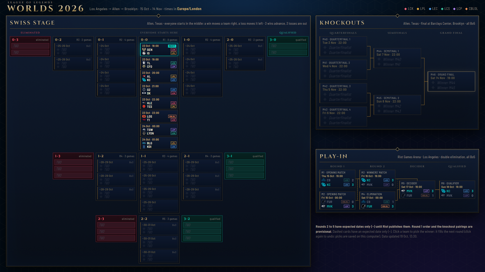

# Worlds 2026 Map

A fixed, Riot-styled wallpaper of every game at the League of Legends World Championship 2026: Play-In and knockout brackets, the Swiss stage laid out by win/loss record, team logos with region tags, and every date and time in your own time zone. It updates itself from this repository, so there is nothing to keep downloading.



## Install (Lively Wallpaper, Windows)

The easiest way needs no download at all, and it is always the latest version:

1. Install [Lively Wallpaper](https://rocksdanister.github.io/lively/) (free).
2. In Lively, click the **+** (Add Wallpaper) button, paste this address and press Enter:

   `https://frodgepodge.github.io/worlds-2026-map/`

3. Click the new tile to set it as your wallpaper. It updates itself from then on.

**Prefer a file?** [](https://github.com/FrodgePodge/worlds-2026-map/releases/latest/download/worlds-2026-map.zip) Don't unzip it: drag the zip into Lively's window. The results still update on their own, but you would need to download again for new features.

No Lively? Open the address above in any browser and press F11.

**More than one monitor?** The map is one 1920x1080 picture. If your wallpaper spans several screens, add `?monitor=2` to the address to put it on the second one (`?monitor=1` is the first). To show times in another time zone, add `&tz=America/New_York`.
## Using it

- **Next game** is highlighted in teal, and a game in progress shows LIVE.
- **Hover a team** to see its roster. This needs Lively's mouse input switched on (see below).
- **Click a team** to pick the winner. It fills into the next round, so you can build a bracket as you go and see your champion. Click again to undo. This needs Lively's mouse input switched on (Lively settings, Wallpaper, "Input"); picks are saved on your computer only.
- Dashed cards only have an expected date. Riot hasn't published later Swiss rounds yet, and the knockout teams are drawn after the Swiss stage.

## Live updates

The page checks `data.json` in this repository every 10 minutes and redraws when it is newer than the copy in your download. Results and the draws are committed here as they happen. If you are offline it keeps showing the bundled copy.

## Settings

With the downloaded zip, open `config.js` in the folder Lively keeps the wallpaper in (right-click the tile, then "Open file location"). The web version uses the address options above instead.

| Setting | What it does |
|---|---|
| `monitor` | With a multi-monitor wallpaper, which screen shows the map (1 = leftmost) |
| `timezone` | Show times in a fixed zone, such as `"Europe/London"`. Empty uses your computer's zone |
| `remoteData` | Where live results come from. Empty string = fully offline |

## For maintainers

All results, fixtures and teams live in `data.json`; `data.js` is a copy of it bundled for offline use.

1. Edit `data.json` (set `updated` to the current UTC time, since newer copies win).
2. Run `./sync-data.ps1` to rebuild `data.js`.
3. Commit both and push. Everyone's copy updates within about 15 minutes.

A match looks like this:

```json
{"id":"M40","t":"2026-11-03T22:00:00.000Z","bo":5,"lab":"Quarterfinal 1","la":"Quarterfinalist","lb":"Quarterfinalist","a":"GENG","b":"AL","sa":3,"sb":1}
```

| Field | Meaning |
|---|---|
| `id` | Match number |
| `t` | Start time in UTC. Without it, `when` (text such as `"25–26 Oct"`) is shown as an expected date |
| `bo` | Best of 1, 3 or 5 |
| `a`, `b` | Team keys from `teams`. Leave them out until Riot's draw is known |
| `sa`, `sb` | Scores, once played |
| `la`, `lb` | Placeholder text shown while a slot is empty |
| `fa`, `fb` | Which match's winner fills the slot (this is how the bracket flows) |
| `rec`, `rd` | Swiss only: both teams' record before the game, and the round number |

Each team in `teams` has a `roster` (a list of `[role, name]` pairs shown when you hover it) and an optional `rosterNote`.

To release a new download for the button, push a tag such as `v1.1` and the workflow attaches the zip.

## Credits and disclaimer

Worlds 2026 Map isn't endorsed by Riot Games and doesn't reflect the views or opinions of Riot Games or anyone officially involved in producing or managing Riot Games properties. Riot Games and all associated properties are trademarks or registered trademarks of Riot Games, Inc. Team names and logos belong to their respective teams. This is a free fan project and is not affiliated with Riot Games.

The code is MIT licensed (see `LICENSE`); the team logos in `icons/` are not covered by that licence.
